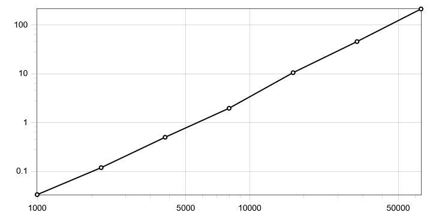
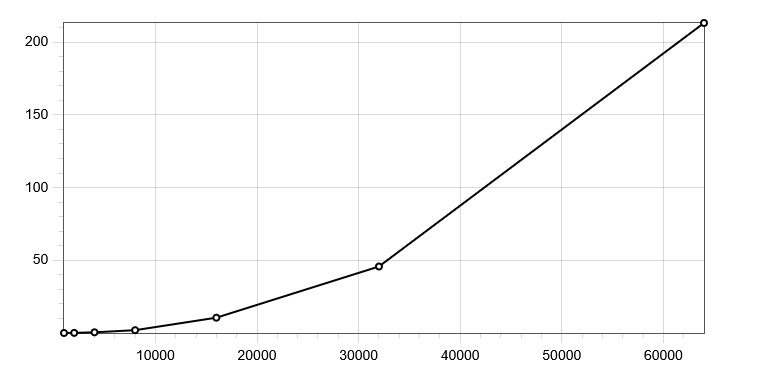
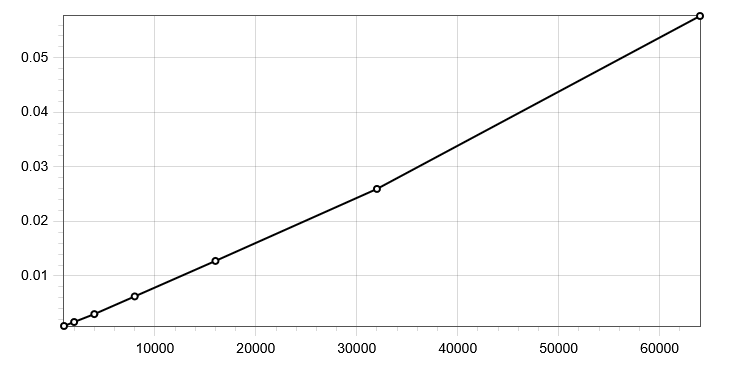
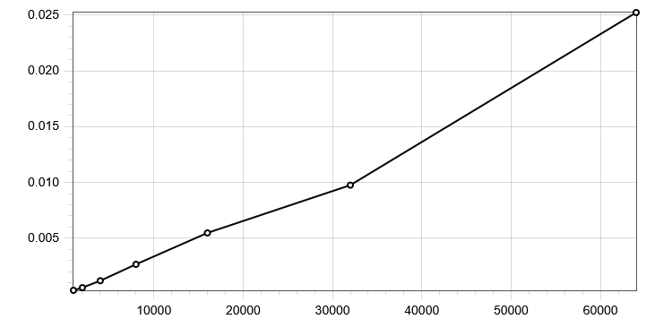

**Machine:** 12th Gen Intel(R) Core(TM) i5-12400F - 2.50 GHz, 16 GB RAM, NVIDIA GeForce RTX 3060 Ti (8Gb) - Windows 10 Pro 22H2
**Language:** Python 3.11.5

All measurements below were produced by running `experiment.py` with `--match-rate 10 --seed 0` and sizes `1000, 2000, 4000, 8000, 16000, 32000, 64000`. The full CSV output is in the generated csv.
## 8.3 Experiment tables

`R join[R.b=S.b] S` :

|n|m|comparisons|wall time (s)|output tuples|
|---|---|---|---|---|
|1000|1000|1,000,000|0.0335|10,169|
|2000|2000|4,000,000|0.1197|19,756|
|4000|4000|16,000,000|0.5023|39,977|
|8000|8000|64,000,000|1.9718|79,669|
|16000|16000|256,000,000|10.5536|159,823|
|32000|32000|1,024,000,000|45.7513|319,454|
|64000|64000|4,096,000,000|213.1580|640,388|

For question 3, the select and project measurements:

| n     | select time (s) | project time (s) |
| ----- | --------------- | ---------------- |
| 1000  | 0.00083         | 0.00033          |
| 2000  | 0.00156         | 0.00057          |
| 4000  | 0.00301         | 0.00119          |
| 8000  | 0.00625         | 0.00266          |
| 16000 | 0.01276         | 0.00548          |
| 32000 | 0.02595         | 0.00976          |
| 64000 | 0.05765         | 0.02524          |

## 8.4 Questions

### 1. What is the exact relationship between n, m and your comparison count? Does the measured count match the formula exactly? If it does not, explain the discrepancy.

The comparison count for `R join[R.b=S.b] S` is exactly the product of the cardinalities of the two input relations:

$comparisons= ∣R∣×∣S∣$

In the experiment, the data generator produces `R(a,b)` with `n` unique tuples and `S(b,c)` with `m` unique tuples. Because both relations are sets and the generated tuples are distinct, the set semantics do not discard any tuples. Therefore:

$|R∣=n,∣S∣=m∣R∣=n,∣S∣=m$

and the comparison count is:

$comparisons=n×m$`

Looking at the measured results in `results_k10.csv`:

|n|m|join_pairs|n × m|
|---|---|---|---|
|1000|1000|1,000,000|1,000,000|
|2000|2000|4,000,000|4,000,000|
|4000|4000|16,000,000|16,000,000|
|8000|8000|64,000,000|64,000,000|
|16000|16000|256,000,000|256,000,000|
|32000|32000|1,024,000,000|1,024,000,000|
|64000|64000|4,096,000,000|4,096,000,000|

The measured count matches $n×m$ exactly. There is no discrepancy.

The reason is that the join is implemented as a nested-loop join: for each tuple in the left relation, it iterates over every tuple in the right relation, incrementing the counter once per pair before checking the join condition. Since the input relations contain exactly `n` and `m` distinct tuples, the total number of pair comparisons is precisely the Cartesian product.

If the input relations had contained duplicate tuples, the set semantics would have collapsed them, making $∣R∣<n$ or $∣S∣<m$, and the comparison count would have been $∣R∣×∣S∣$ instead. But the data generator deliberately creates unique tuples, so the simple formula $n×m$ holds exactly.

### 2. Plot time against n on log-log axes. What is the slope, and what does that slope tell you about the algorithm?

On a log-log plot of wall time versus $n$ (with $m=n$), the join timings lie approximately on a straight line. 

**x = n, y = wall time (s)**


Taking logarithms and fitting a line gives a slope of approximately 2.1. For example, between the first and last points:

$\frac{log⁡10(213.158)−log⁡10(0.0335)}{log⁡10(64000)−log⁡10(1000)}= \frac{3.803}{1.806}≈2.105.$

So:

$\frac{Δlog⁡(time)}{Δlog⁡(n)}≈2.1.$


A slope of about 2.1 on log-log axes means that the running time grows as a power law:

$time∝n^α,α≈2.$

The exponent $α≈2$ tells us that the join algorithm is quadratic in the input size. This is exactly what we expect from a nested-loop join: for equal sized inputs $n=m$, the number of tuple pairs compared is

$∣R∣×∣S∣=n×n=n^2$

Since the engine increments the comparison counter once per pair, the comparison count is  $n^2$. The wall time follows the same quadratic trend. The slope is approximately 2.1, which confirms that the join is an $O(n^2)$ nested loops algorithm. It scales quadratically, so doubling the input size roughly quadruples the running time.

### 3. Measure select and project at the same sizes. How do those curves differ from the join, and why?

**Join: x = n, y = wall time (s)**


**Select: x = n, y = wall time (s)**


**Project: x = n, y = wall time (s)**



The select and project curves are both linear in $n$, whereas the join curve is quadratic. From the measured data doubling $n$ roughly doubles the wall time for select and project, but roughly quadruples it for the join. 

**Join** is a binary operator that compares every tuple of the left relation with every tuple of the right relation. For equal-sized inputs $n=m$, it performs $n×n=n^2$ pair comparisons. That nested-loop structure is what makes the join quadratic.

**Select** examines each tuple of the input exactly once, evaluates a condition, and keeps or discards it. That is a single pass over the relation, so the work is proportional to the number of input tuples: $O(n)$.

**Project** also scans each tuple exactly once, extracts the requested attributes, and inserts the resulting tuple into a set to remove duplicates. Set insertion is $O(1)$ on average, so the total work is still $O(n)$.

### 4. Using your measurements, predict how long the join would take with one million tuples on each side. Show the arithmetic. Do not run it.

Using the measured join time at $n=64,000$, the nested-loop join is quadratic, so we scale by the square of the size ratio.

At $n=64,000:$

$T(64,000)=213.158 s$

For $n=1,000,000$:

$1,000,000/64,000=15.625$

Since time grows as $n^2$,

$T(1,000,000)≈T(64,000)×(15.625)^2$
$(15.625)^2=244.140625$
$T(1,000,000)≈213.158×244.140625$
$T(1,000,000)≈52,040 s$

So the predicted wall time is approximately 52,040 seconds, or about 14.5 hours. 

### 5. Does changing the match rate change the comparison count? Does it change the wall time? Explain why those two answers differ.

Changing the match rate does **not** change the comparison count, but it **does** change the wall time.

In our implementation, `op_join` uses a nested-loop join. For a simple equality join such as `R join[R.b=S.b] S`, the fast path enumerates every pair of tuples exactly once:


```
for lrow in left_rows:
    lval = lrow[li]
    for rrow in right_rows:
        jp += 1
        if lval == rrow[ri]:
            new_rows.add(lrow + rrow)
```

The counter `jp` is incremented before the equality check, so it counts every pair of tuples regardless of whether the join condition is satisfied. The total is therefore always

$comparisons=∣R∣×∣S∣=n×m$,

independent of the match rate. The match rate is controlled by the domain size `d = m // k`, which determines how many `S` tuples share each `b` value with an `R` tuple. It affects how many pairs pass the equality test, but not how many pairs are compared.

The wall time, however, does depend on the match rate. Every time the equality test succeeds, the engine must: concatenate the two tuples (`lrow + rrow`), hash the resulting tuple, and insert it into the output set `new_rows` (which also deduplicates).

A higher match rate means more successful matches, so more tuple concatenations and set insertions. That extra work increases the wall time. A lower match rate produces fewer output tuples and therefore less of this post-comparison work.

The two answers differ because the comparison count measures only the nested-loop enumeration of tuple pairs, which is fixed by the input cardinalities. Wall time measures the entire execution, including the work performed after a comparison succeeds. The match rate does not change the number of comparisons, but it changes how many times the body of the inner loop does the extra work of building and storing an output tuple. So the comparison count stays exactly $n×m$, while wall time grows slowly with the match rate.

### 6. In one paragraph, describe what you would have to change to make the million-tuple join feasible. You do not have to implement it.

To make the million-tuple join feasible, I would replace the nested-loop join with a hash join. The current implementation enumerates all $n×m$ pairs, producing $10^{12}$ comparisons and an estimated runtime of about 14.5 hours. A hash join would build a hash table on the smaller relation keyed by the join attribute `b`, then scan the larger relation once and probe the table for matches. This would reduce the work to roughly $O(n+m)$ expected time with 2 million operations which would complete in seconds (disregarding memory).